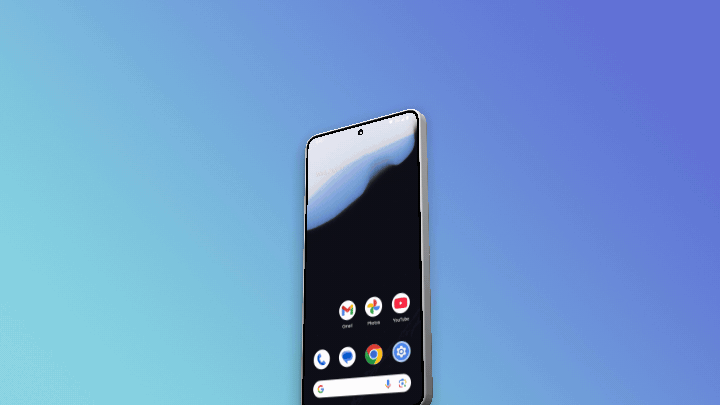
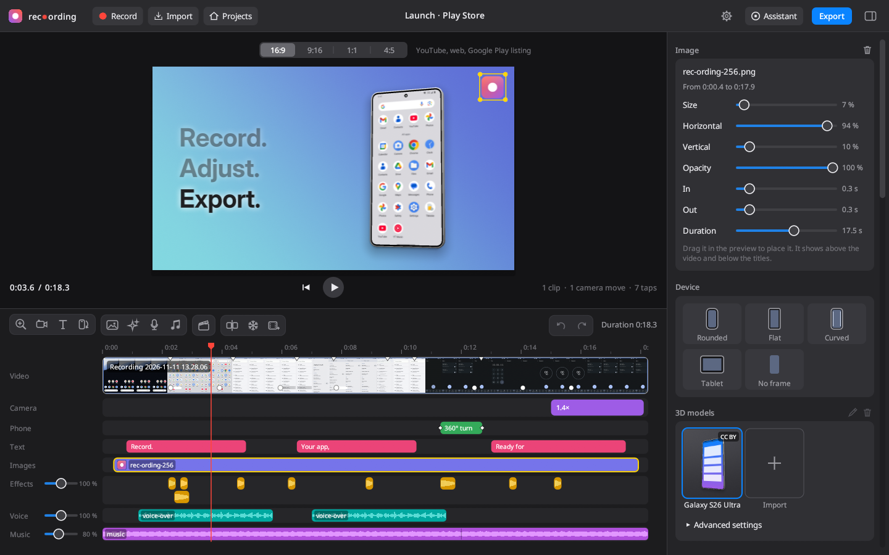
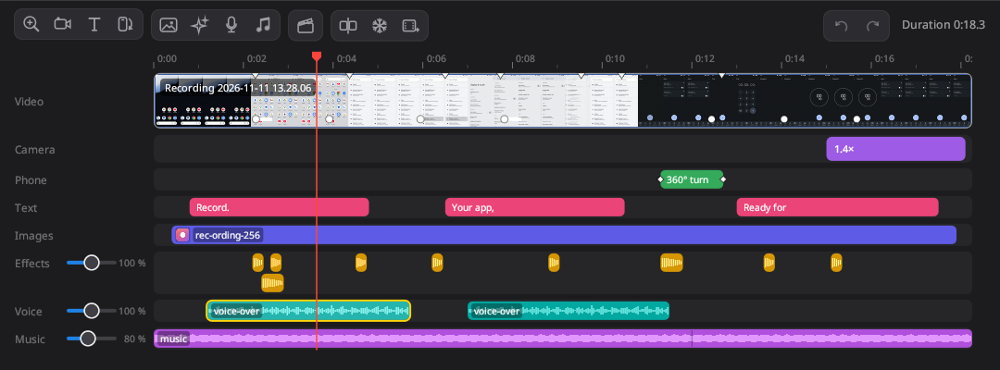
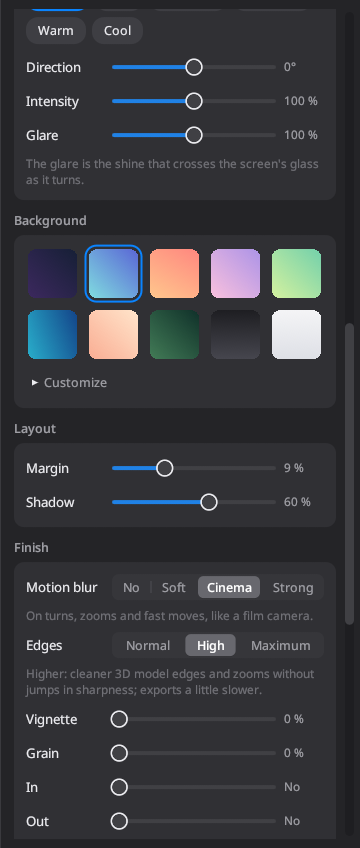
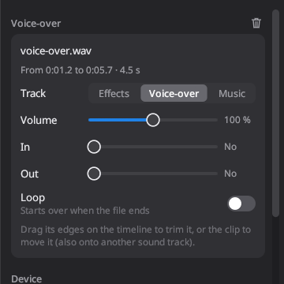
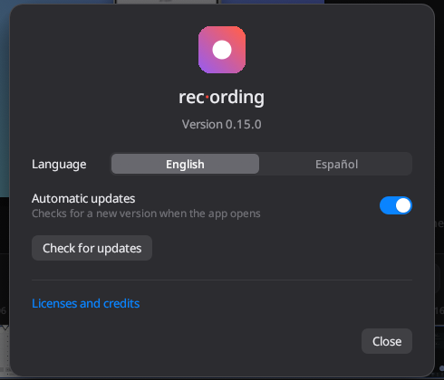

# rec·ording

**English** · [Español](README.es.md)

(The package and the executable are called `rec-ording`.)

Record your Android phone over USB and turn it into a promo video ready to publish: your app inside a phone frame, on a polished background, with smooth zooms that follow every tap.

Made for the Google Play listing, YouTube, Reels/Shorts or social media, without going through a video editor.

The app is in English and Spanish: choose the language in the settings (the gear button).

<p align="center">
  
</p>

<p align="center"><strong><a href="https://blzkz.github.io/rec-ording-releases/">Download for Windows and Linux</a></strong></p>

## Screenshots

**Start screen.** Create a project or go back to a recent one, each shown with a picture of its video.


**Editor.** The 3D phone with your recording, and below it every track: video, camera, phone, text, images and sound.


**Images with transparency.** Place them by dragging them over the video.



**Effects, voice-over and music.** Several sounds per track, each with its waveform and its own volume, and the music lowers itself while the voice speaks.



<table>
  <tr>
    <th>Light and finish</th>
    <th>Sound settings</th>
    <th>App settings</th>
  </tr>
  <tr>
    <td valign="top"></td>
    <td valign="top"></td>
    <td valign="top"></td>
  </tr>
</table>

## How it works

The app opens on the **start screen**: create a new project, open one you already have (or a `.recproj.json` file from another folder) or pick one of the last five, shown with a picture of their video. **Projects**, in the top bar, saves the open project and goes back to the start screen.

1. **Record.** Connect the phone over USB (with USB debugging on), press **Record** and use your app as usual. rec-ording records where you tap. With **Clean status bar** (on by default) the phone shows 9:41, a full battery and no notifications while you record, and goes back to normal when you finish.
   You can also record an Android Studio **emulator**: open it from the Device Manager and it shows up in the list with the name of its virtual device. Clicks in its window are recorded as taps.
   Already have a recording? Press **Import** or drag the video onto the window.
2. **Adjust.** Choose the format (16:9, 9:16, 1:1, 4:5), the device (rounded, flat, curved, tablet or no frame) and its color, the background, margin and shadow.
   **3D models** is a gallery of 3D phones (the Galaxy S26 Ultra is included) where you can **import** your own as `.glb`, `.gltf` or straight from the downloaded `.zip` (loose textures and `.bin` files are copied to your gallery with the model; a model that can't be used is not added). To rename or delete an imported model, select it and use the pencil or trash icon next to the title, or right-click it. rec-ording finds the screen, straightens the model and projects your recording onto it. In **Advanced settings**, in the same section, you choose the part that acts as the screen, how the video fits (**Fill** by cropping, **Fit** with black bars, or **Stretch**) and, if the model has animations, which one to play and whether it loops. CC BY models ask you to credit their author when you publish the video: the Galaxy S26 Ultra is by [Sagar Modi](https://sketchfab.com/modis1761) ([Sketchfab](https://sketchfab.com/3d-models/samsung-s26-ultra-7ff228963ea446f39f46a5541f71e352), CC BY 4.0; see `assets/models/CREDITS.md`).
   In **3D angle** you can turn and tilt the phone (with real edges and reflections), have it straighten when zooming in, float gently or spin in at the start.
   Zooms are created automatically from the taps; you can move them, stretch them, change their level or choose where they focus by clicking on the preview.
3. **Edit.** The timeline has these tracks:
   - **Video**: several recordings one after another. Drag a clip's edges to trim it, drag the clip to reorder it, and use **Split** (Ctrl+B) to cut it at the playhead; the film button with a "+" adds another video at the end. In the clip's panel you can change its **speed** (0.25× to 4×), **freeze a frame** for as long as you want or **replace its video** with another recording, keeping its trims and everything on top of it. The small white marks show screen changes (scrolling, keyboard, dialogs): titles, zooms and moves snap to them when dragged, and everything on the timeline stays with its moment of the recording when clips are trimmed or moved.
   - **Camera**: zooms, keyframed **moves** (zoom, framing, tilt, turn and roll, arriving with a spring, smooth, linear or cut easing) and **Director** shots. This is how you turn the phone halfway through the video.
   - **Phone**: device moves: a **360° turn** around the vertical axis, a **360° flip** around the horizontal one, spin in, drop in from above, rise from below, a small hop and an exit. For turns you choose the number of turns, direction and duration; placed next to a cut, they center on it so the cut happens while the back of the phone is showing. Fast moves get motion blur.
   - **Text**: titles in the style of Apple's ads, next to the phone (which moves aside to make room and, if you want, turns slightly towards them), at the top, bottom or center. A headline (one line per line break) and an optional smaller line below; a large size for figures ("100 / real cities."). They appear with a fade, word by word or line by line (earlier lines dim). Add them with the **T** button, the T key or a double click on the track.
   - **Images**: logos, badges or any PNG, WebP or JPEG, with their transparency, above the video and below the titles. Drag them in the preview to place them; their panel sets size, opacity, fades and duration. Several can show at once.
   - **Effects**, **Voice** and **Music**: sounds (mp3, wav, m4a, ogg, flac…) mixed with the recording's own sound. Each track holds several sounds at once, stacked in lanes. Drag a clip to move it (also onto another sound track) and its edges to trim it; its panel sets volume, fades and looping. By default music fills the rest of the video, repeating if it's short, and lowers itself while the voice-over speaks. Each track has its own volume next to its name on the timeline; in the panel, **Sound** gathers those volumes and the recording's. The preview plays the full mix.
   To add images and sounds, use their buttons in the timeline toolbar, double-click the track or drag the file onto the window (it goes at the playhead).
   The **Director** works like in Matte: move the playhead to each important moment, drag over the preview what should be seen and press **Generate shots**. Choose 3D movement (angles and orbits) or 2D (flat zoom) and its intensity, and ask for **another take** of a shot you don't like.
   The timeline tools are icons, grouped as in video editors (add zoom, camera move, text and phone move; Director; split, freeze frame and add video; undo and redo); hovering shows their name and shortcut. Everything can be undone (Ctrl+Z) and redone (Ctrl+Shift+Z).
   The settings panel on the right can be widened by dragging its edge and hidden with the button in the top right corner (Ctrl+4) for a bigger preview.
   In **Lighting** you choose the phone's light: **Studio**, **Soft**, **Dramatic**, **Backlight**, **Warm** or **Cool**, with its direction, intensity and the screen's glare. The shadow follows the light. In **Finish**: motion blur (also on zooms and animations), edge quality, vignette, grain, fade in and out to black, and crossfades between clips.
4. **Export** as MP4 (H.264 or HEVC) or GIF, at 720p, 1080p or 4K, at 30 or 60 fps, with sound. With a graphics card, the export uses it to draw the frames (Vulkan, DirectX 12 or Metal) and to encode the video (NVENC on NVIDIA, VAAPI on AMD and Intel on Linux, AMF or Quick Sync on Windows); if something fails, it is done again on the processor. A 16 s video at 1080p60 with a 3D model takes about 6 s instead of 40 s. Every export comes out in BT.709 (TV range) and tagged, whether done on the graphics card or the processor. The preview is also drawn on the graphics card, with the export's blur and edges even while playing (without a graphics card, the processor draws it with the same result).

### Shortcuts

| Key | Action |
| --- | --- |
| Space | Play / pause |
| Z | Add a zoom at the playhead |
| T | Add a title at the playhead |
| Ctrl+B | Split the clip at the playhead |
| Ctrl+Z / Ctrl+Shift+Z | Undo / redo |
| Ctrl+4 | Show or hide the settings panel |
| Delete / Backspace | Delete the selection (clip, move, title, keyframe or target) |
| Esc | Clear the selection (to see the result) or leave the Director |
| ← / → | Previous / next frame (with Shift: 1 second) |
| Home / End | Go to the start / end |

## Requirements

```bash
sudo pacman -S ffmpeg android-tools scrcpy zenity
```

- **ffmpeg**: reads and exports video (required).
- **scrcpy** (recommended): records with sound and no time limit. Without scrcpy, `adb screenrecord` is used (3 minutes at most, no sound).
- **android-tools** (`adb`): finds the phone and records the taps.
- **zenity** or **kdialog**: file pickers (you can also drag videos onto the window).

Recordings and exports are saved to `rec-ording` in your Videos folder. Projects save themselves to `~/.local/share/rec-ording/proyectos/`.

## Assistant (MCP)

An agent (Claude, Cursor, Codex…) can edit the video for you with `rec-ording --mcp`, an MCP server over stdio that edits the project open in the app (the app shows its changes right away and they can be undone). The app's **Assistant** button shows the configuration ready to copy. The server's tool descriptions and replies are in Spanish, whatever language the app shows. For example, in Claude Code:

```bash
claude mcp add rec-ording -- /usr/bin/rec-ording --mcp
```

Tools: projects (`get_project`, `create_project`, `open_project`, `undo`…), recording and importing, clip editing (also speed, `freeze_frame` and `replace_clip_video`), zooms and camera keyframes, the Director, device and 3D models, phone moves with 360° turns (`add_device_motion`, `update_device_motion`), titles (`add_text`, `update_text`, `delete_text`, `export_texts`, `import_texts`), images (`add_image`, `update_image`, `delete_image`), sounds on the effects, voice and music tracks (`add_sound`, `update_sound`, `delete_sound`) and the mix (`set_mix`), style with lighting and finish (`set_style`), `render_frame` (returns a picture of the result), `render_strip` (several moments in one picture), `render_preview` (a short video of a stretch), `get_hardware` (which graphics card and encoder there are) and `export` (with `hardware` to use the graphics card or not).

Also:

- Every tool takes `project` to work on a given project even if another one is open in the app, and every answer says which project it acted on.
- `batch` runs several operations in one call, undone in one step.
- `play_gestures` taps, swipes and types on the phone while recording; each gesture is recorded as a tap (with its circle and its automatic zoom).
- `detect_marks` finds the screen changes, and the tools that place something in time take `mark` instead of seconds.
- When a new version is installed, the server restarts itself and tells the client that the tools have changed.

## Installation

The packages of the latest version are on the download page, https://blzkz.github.io/rec-ording-releases/:

| System | File | How to install |
| --- | --- | --- |
| Arch, CachyOS, Manjaro | `rec-ording-<version>-1-x86_64.pkg.tar.zst` | `sudo pacman -U <file>` |
| Debian, Ubuntu, Linux Mint, Pop!_OS | `rec-ording_<version>-1_amd64.deb` | `sudo apt install ./<file>` |
| Fedora, openSUSE | `rec-ording-<version>-1.x86_64.rpm` | `sudo dnf install ./<file>` or `sudo zypper install <file>` |
| Any other distribution | `rec-ording-<version>-x86_64.AppImage` | `chmod +x <file>` and open it |
| Windows | `rec-ording-<version>-windows-x64.zip` | Unzip it and open `rec-ording.exe` |

The Linux packages need glibc 2.35 or newer (Ubuntu 22.04, Debian 12, Fedora 36 or later). The .deb and .rpm install ffmpeg and recommend adb, scrcpy and zenity; with the AppImage you install them yourself. On Fedora, ffmpeg comes from `ffmpeg-free` (or from RPM Fusion).

From the repository, on CachyOS:

```bash
./install-cachyos.sh
```

or building it yourself:

```bash
cargo build --release
./target/release/rec-ording
```

### Updates

When it opens, the app reads `latest.json` from the download page (GitHub Pages of the public `blzkz/rec-ording-releases` repository, which only holds the packages). GitHub Releases are not used because they always show "Source code" archives. If there is a new version, a window says so and offers to update (the **Update** button also stays in the toolbar):

- on Linux it installs the package with the system's package manager through `pkexec` (pacman, apt, dnf or zypper, depending on how it was installed; it asks for your password), or replaces the file for an AppImage;
- on Windows it replaces the files in the rec-ording folder;
- in a copy built by hand, it opens the download page.

Then just restart. Downloads are checked against the SHA-256 checksum in `latest.json`.

The gear button in the top bar shows the installed version and the link to licenses and credits, looks for updates on request and lets you turn off **Automatic updates** (on by default): without them, the app doesn't look for new versions when it opens.

To publish a version, push a `vX.Y.Z` tag (matching the version in `Cargo.toml` and the `PKGBUILD`). The **Release** workflow runs the tests and builds on Arch, on Ubuntu 22.04 (`.deb`, `.rpm` and AppImage with `packaging/linux/build-packages.sh`) and on Windows, then publishes the download page: `packaging/site/make-site.py` generates `index.html`, `licencias.html` and `latest.json` with the packages and their SHA-256 checksums, and they are pushed to the `gh-pages` branch of the public repository (only the latest version). The notes are the annotated tag's message, in Markdown (`git tag -a vX.Y.Z -F notes.md`). It needs the `RELEASES_TOKEN` secret: a fine-grained token with *Contents: read and write* permission on `blzkz/rec-ording-releases` only. Without it, the packages stay as artifacts of the run and the publish step fails saying so.

### Windows

Download `rec-ording-<version>-windows-x64.zip`, unzip it and open `rec-ording.exe`. It is built by the **Release** GitHub Actions workflow when a `v*` tag is pushed (it can also be started by hand from the Actions tab to try a build, without publishing). Install the tools with:

```powershell
winget install Gyan.FFmpeg
winget install Google.PlatformTools
winget install Genymobile.scrcpy
```

On Windows recordings are saved as `.mkv` (scrcpy can't be stopped cleanly from another process, and a cut-off MKV still plays). Projects are in `%APPDATA%\rec-ording`.

To build it from Linux (needs `rustup target add x86_64-pc-windows-gnu` and `mingw-w64-gcc`):

```bash
./packaging/windows/build-local.sh
```

## How it's made

A native Rust app built with [egui](https://github.com/emilk/egui).

| Module | What it does |
| --- | --- |
| `capture.rs` | Records with scrcpy (or `adb screenrecord`) and reads the touchscreen's taps with `getevent`, in sync with the video. It also plays gestures with `adb shell input` and turns on Android's demo mode. |
| `timeline.rs` | The timeline: clips, keyframed camera and phone moves, automatic zoom, the Director and every editing operation (used by both the app and the MCP server). |
| `mcp.rs` | The MCP server (`rec-ording --mcp`). |
| `compositor.rs` | Draws each frame: background, shadow, the 3D phone (perspective, thickness and lighting), the recording and the taps. The preview and the export share the same code. |
| `media.rs` | Reads videos with ffprobe/ffmpeg, makes a light copy so the preview plays smoothly and generates the thumbnails. |
| `model3d.rs` | Loads glTF/GLB models (with node animations), finds and straightens the screen and rasterizes them with perspective, textures and lighting. |
| `library.rs` | The model gallery: the ones included in `assets/models` and the imported ones, with rendered thumbnails. |
| `export.rs` | Decodes the recording, composes each frame and encodes the result with ffmpeg. |
| `app/`, `theme.rs` | The interface: start screen, viewer, timeline, inspector and sheets; the tools' drawn icons. |
| `thumbs.rs` | The picture of each project for the start screen, drawn like the export and cached. |
| `images.rs` | Images over the video: reads them with ffmpeg, keeps their transparency and draws them under the titles (also in the layer sent to the graphics card). |
| `audio.rs` | Sound: mixes the recording with the effects, voice and music tracks (one ffmpeg graph for both the export and the preview), waveforms and playback in the preview (cpal). |
| `text.rs` | Titles: layout with Inter Display (included in `assets/fonts`, OFL license), entry and exit animations, and the room the phone leaves for them. |
| `gpu/` | The compositor on the graphics card (wgpu): the same maths as `compositor.rs` in WGSL shaders. Draws the export and the preview (on the same card as the window, without copying the picture back). Tests compare its frames with the processor's. |
| `post.rs` | The finish: vignette, grain and fades, the same on the processor and the graphics card. |
| `hwenc.rs` | Encoding on the graphics card (NVENC, AMF, Quick Sync, VAAPI): tests what works on the computer. |
| `update.rs` | Looks for new versions on the download page and installs them with the system's package manager, by replacing the AppImage or the folder on Windows. |
| `platform.rs` | What differs between Linux and Windows: folders, file pickers, opening files and starting tools without a console window. |

Tests: `cargo test` (includes a test that builds and exports a video through the MCP server). With a real video or phone:

```bash
REC_TEST_VIDEO=/path/video.mp4 cargo test exports_real_video -- --ignored
REC_TEST_SERIAL=<adb serial> cargo test records_from_device -- --ignored
REC_TEST_VIDEO=/path/video.mp4 REC_TEST_MODEL=/path/phone.glb cargo test exports_real_video -- --ignored
```
