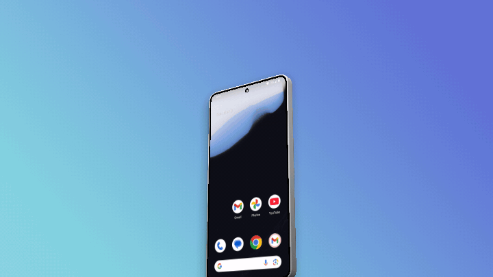
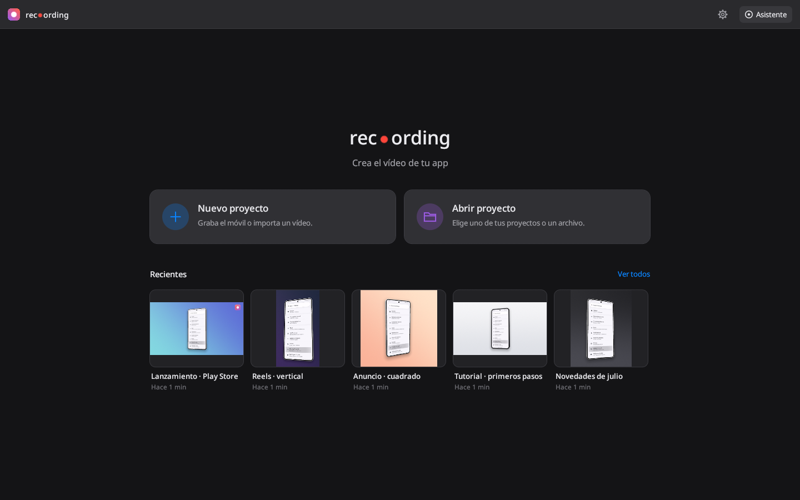
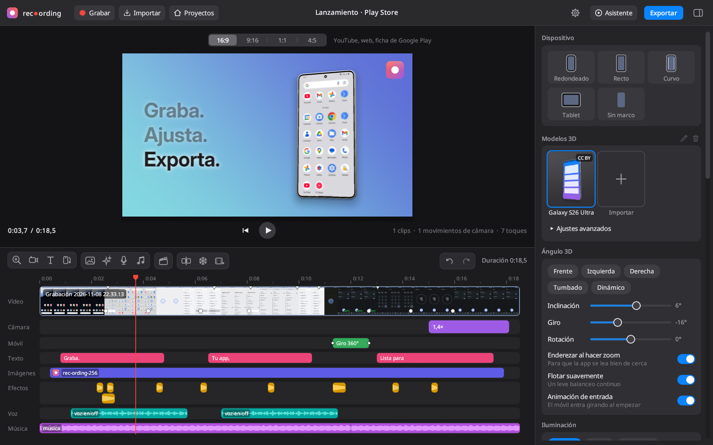
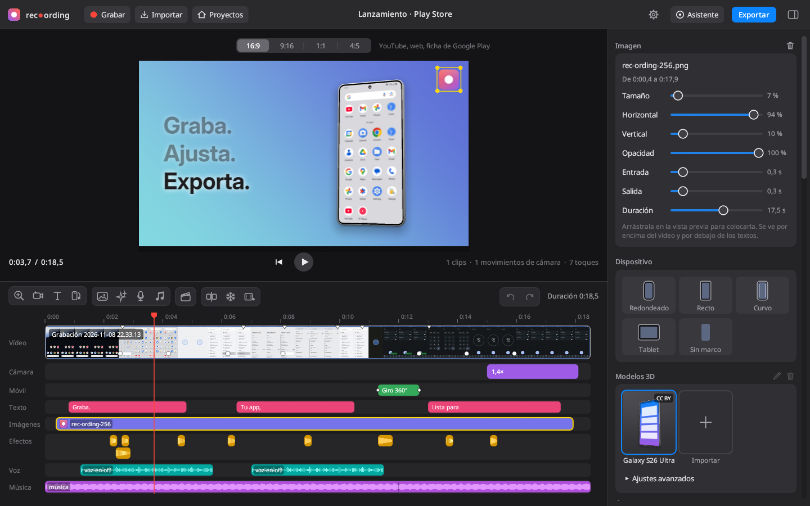
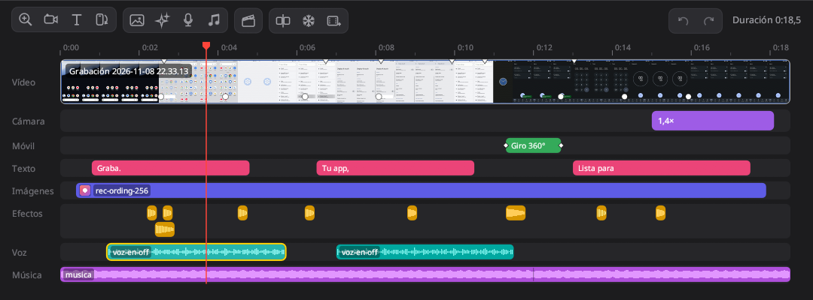
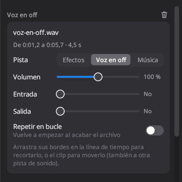
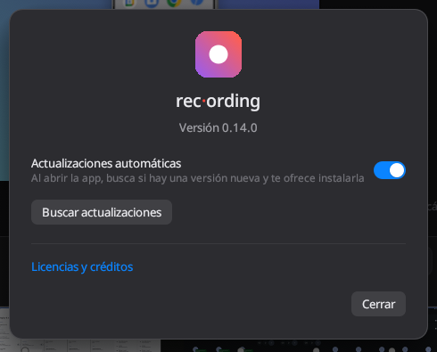

# rec·ording

(El paquete y el ejecutable se llaman `rec-ording`.)

Graba tu móvil Android por USB y conviértelo en un vídeo promocional listo para publicar: tu app dentro de un marco de móvil, sobre un fondo cuidado, con zooms suaves que siguen cada toque.

Pensado para la ficha de Google Play, YouTube, Reels/Shorts o redes, sin pasar por un editor de vídeo.

<p align="center">
  
</p>

<p align="center"><strong><a href="https://blzkz.github.io/rec-ording-releases/">Descargar para Windows y Linux</a></strong></p>

## Capturas

**Inicio.** Crea un proyecto o vuelve a uno reciente, cada uno con una imagen de su vídeo.



**Editor.** El móvil en 3D con tu grabación, y debajo todas las pistas: vídeo, cámara, móvil, texto, imágenes y sonido.



**Imágenes con transparencia.** Se colocan arrastrándolas sobre el vídeo.



**Efectos, voz y música.** Varios sonidos por pista, con su forma de onda, y la música baja sola cuando habla la voz.



<table>
  <tr>
    <th>Luz y acabado</th>
    <th>Ajustes de un sonido</th>
    <th>Ajustes de la app</th>
  </tr>
  <tr>
    <td valign="top"></td>
    <td valign="top"></td>
    <td valign="top"></td>
  </tr>
</table>

## Cómo se usa

Al abrir la app ves el **inicio**: crea un proyecto nuevo, abre uno que ya tengas (o un archivo `.recproj.json` de otra carpeta) o elige uno de los cinco últimos, que aparecen con una imagen de su vídeo. **Proyectos**, en la barra de arriba, guarda el proyecto abierto y vuelve al inicio.

1. **Graba.** Conecta el móvil por USB (con la depuración USB activada), pulsa **Grabar** y usa tu app con normalidad. rec-ording registra dónde tocas. Con **Barra de estado limpia** (activada por defecto) el móvil muestra las 9:41, la batería llena y ninguna notificación mientras grabas, y vuelve a la normalidad al terminar.
   También puedes grabar un **emulador** de Android Studio: ábrelo desde el Device Manager y aparecerá en la lista con el nombre de su dispositivo virtual. Los clics que hagas en su ventana se registran como toques.
   ¿Ya tienes una grabación? Pulsa **Importar** o arrastra el vídeo a la ventana.
2. **Ajusta.** Elige formato (16:9, 9:16, 1:1, 4:5), modelo (redondeado, recto, curvo, tablet o sin marco) y color del dispositivo, fondo, margen y sombra.
   En **Modelos 3D** tienes una galería de móviles en 3D (incluye el Galaxy S26 Ultra) y puedes **importar** los tuyos en `.glb`, `.gltf` o directamente el `.zip` de la descarga (las texturas y `.bin` sueltos se copian a tu galería con el modelo; si el modelo no se puede usar, no se añade). Para renombrar o eliminar un modelo importado, selecciónalo y usa el lápiz o la papelera junto al título, o haz clic derecho sobre él. rec-ording busca la pantalla, endereza el modelo y proyecta tu grabación en ella. En **Ajustes avanzados**, dentro de la misma sección, eliges la pieza que hace de pantalla, cómo encaja el vídeo (**Rellenar** recortando, **Encajar** con bandas negras o **Estirar**) y, si el modelo trae animaciones, cuál reproducir y si se repite. Los modelos con licencia CC BY piden mencionar a su autor al publicar el vídeo: el Galaxy S26 Ultra es de [Sagar Modi](https://sketchfab.com/modis1761) ([Sketchfab](https://sketchfab.com/3d-models/samsung-s26-ultra-7ff228963ea446f39f46a5541f71e352), CC BY 4.0; ver `assets/models/CREDITS.md`).
   En **Ángulo 3D** puedes girar e inclinar el móvil (con cantos y reflejos reales), hacer que se enderece al hacer zoom, que flote suavemente o que entre girando al empezar.
   Los zooms se crean solos a partir de los toques; puedes moverlos, alargarlos, cambiar su nivel o elegir dónde enfocan haciendo clic en la vista previa.
3. **Monta.** La línea de tiempo tiene estas pistas:
   - **Vídeo**: varias grabaciones seguidas. Arrastra los bordes de un clip para recortarlo, el clip para cambiarlo de orden, y **Dividir** (Ctrl+B) para cortarlo en el cursor; el botón de la película con «+» añade otro vídeo al final. En el panel del clip puedes cambiar su **velocidad** (de 0,25× a 4×), **congelar un fotograma** el tiempo que quieras o **cambiar su vídeo** por otra grabación sin perder recortes ni lo que hay encima. Las pequeñas marcas blancas señalan los cambios de pantalla (scroll, teclado, diálogos): los textos, zooms y movimientos se ajustan a ellas al arrastrarlos, y todo lo que hay en la línea de tiempo sigue a su momento de la grabación al recortar o mover clips.
   - **Cámara**: zooms, **movimientos** con fotogramas clave (zoom, encuadre, inclinación, giro y rotación, con llegada en muelle, suave, lineal o corte) y planos del **Director**. Así puedes girar el móvil a mitad del vídeo.
   - **Móvil**: movimientos del dispositivo: **giro 360°** sobre el eje vertical, **voltereta 360°** sobre el horizontal, entrada girando, caída desde arriba, asomarse desde abajo, saltito y salida. En los giros eliges vueltas, sentido y duración; si los pones junto a un cambio de clip, se centran en él y el corte ocurre mientras se ve la parte de atrás del móvil. Los movimientos rápidos llevan desenfoque de movimiento.
   - **Texto**: títulos al estilo de los anuncios de Apple, junto al móvil (que se aparta para dejarles sitio y, si quieres, gira un poco para mirarlos), arriba, abajo o en el centro. Un titular (una línea por salto de línea) y, si quieres, una línea más pequeña debajo; tamaño grande para cifras («100 / ciudades reales.»). Entran apareciendo, palabra a palabra o línea a línea (las anteriores se atenúan). Se añaden con el botón **T**, la tecla T o doble clic en la pista.
   - **Imágenes**: logos, distintivos o cualquier PNG, WebP o JPEG, con su transparencia, por encima del vídeo y por debajo de los textos. Arrástralas en la vista previa para colocarlas; en su panel eliges tamaño, opacidad, fundidos y duración. Pueden coincidir varias a la vez.
   - **Efectos**, **Voz** y **Música**: sonidos (mp3, wav, m4a, ogg, flac…) que se mezclan con el de la grabación. Cada pista admite varios sonidos a la vez, que se apilan en carriles. Arrastra un clip para moverlo (también a otra pista de sonido) y sus bordes para recortarlo; en su panel ajustas volumen, fundidos y si se repite en bucle. La música llena por defecto el resto del vídeo, repitiéndose si es corta, y baja sola mientras habla la voz en off. En **Sonido** eliges el volumen de la grabación y de cada pista. La vista previa ya suena: reproduce la mezcla completa.
   Para añadir imágenes y sonidos usa sus botones en la barra de la línea de tiempo, haz doble clic en la pista o arrastra el archivo a la ventana (se coloca en el cursor).
   El **Director** funciona como en Matte: mueve el cursor a cada momento importante, arrastra sobre la vista previa lo que debe verse y pulsa **Generar planos**. Elige movimiento 3D (ángulos y órbitas) o 2D (zoom plano), su intensidad, y pide **otra toma** de un plano si no te convence.
   Las herramientas de la línea de tiempo son iconos, agrupados como en los editores de vídeo (añadir zoom, movimiento de cámara, texto y movimiento del móvil; Director; dividir, congelar fotograma y añadir vídeo; deshacer y rehacer); al pasar el ratón por encima se ve su nombre y su atajo. Todo se puede deshacer (Ctrl+Z) y rehacer (Ctrl+Mayús+Z).
   El panel de ajustes de la derecha se puede ensanchar arrastrando su borde y ocultar con el botón de la esquina superior derecha (Ctrl+4) para ver la vista previa más grande.
   En **Iluminación** eliges la luz del móvil: **Estudio**, **Suave**, **Dramática**, **Contraluz**, **Cálida** o **Fría**, con su dirección, intensidad y el reflejo de la pantalla. La sombra sigue a la luz. En **Acabado**: desenfoque de movimiento (también en zooms y animaciones), calidad de los bordes, viñeta, grano, fundido de entrada y a negro, y fundido entre clips.
4. **Exporta** en MP4 (H.264 o HEVC) o GIF, a 720p, 1080p o 4K, a 30 o 60 fps, con el sonido del móvil. Si tienes una tarjeta gráfica, la exportación la usa para dibujar los fotogramas (Vulkan, DirectX 12 o Metal) y para codificar el vídeo (NVENC en NVIDIA, VAAPI en AMD e Intel en Linux, AMF o Quick Sync en Windows); si algo falla, se vuelve a hacer con el procesador. Un vídeo de 16 s a 1080p60 con un modelo 3D tarda unos 6 s en lugar de 40 s. Todas las exportaciones salen en BT.709 (rango TV) y etiquetadas, se hagan con la tarjeta o con el procesador. La vista previa también se dibuja en la tarjeta gráfica, con el desenfoque y los bordes de la exportación incluso mientras se reproduce (sin tarjeta, la dibuja el procesador con el mismo resultado).

### Atajos

| Tecla | Acción |
| --- | --- |
| Espacio | Reproducir / pausar |
| Z | Añadir un zoom en el cursor |
| T | Añadir un texto en el cursor |
| Ctrl+B | Dividir el clip en el cursor |
| Ctrl+Z / Ctrl+Mayús+Z | Deshacer / rehacer |
| Ctrl+4 | Mostrar u ocultar el panel de ajustes |
| Supr / Retroceso | Eliminar lo seleccionado (clip, movimiento, texto, fotograma clave u objetivo) |
| Esc | Quitar la selección (ver el resultado) o salir del Director |
| ← / → | Fotograma anterior / siguiente (con Mayús: 1 segundo) |
| Inicio / Fin | Ir al principio / al final |

## Requisitos

```bash
sudo pacman -S ffmpeg android-tools scrcpy zenity
```

- **ffmpeg**: leer y exportar vídeo (imprescindible).
- **scrcpy** (recomendado): graba con sonido y sin límite de duración. Sin scrcpy se usa `adb screenrecord` (máximo 3 minutos, sin sonido).
- **android-tools** (`adb`): detectar el móvil y registrar los toques.
- **zenity** o **kdialog**: diálogos para elegir archivos (también puedes arrastrar vídeos a la ventana).

Las grabaciones y exportaciones se guardan en `~/Vídeos/rec-ording`. Los proyectos se guardan solos en `~/.local/share/rec-ording/proyectos/`.

## Asistente (MCP)

Un agente (Claude, Cursor, Codex…) puede montar el vídeo por ti con `rec-ording --mcp`, un servidor MCP por stdio que edita el proyecto abierto en la app (la app muestra sus cambios al momento y se pueden deshacer). El botón **Asistente** de la app muestra la configuración lista para copiar. Por ejemplo, en Claude Code:

```bash
claude mcp add rec-ording -- /usr/bin/rec-ording --mcp
```

Herramientas: proyectos (`get_project`, `create_project`, `open_project`, `undo`…), grabar e importar, editar clips (también velocidad, `freeze_frame` y `replace_clip_video`), zooms y fotogramas clave de cámara, Director, dispositivo y modelos 3D, movimientos del móvil con giros de 360° (`add_device_motion`, `update_device_motion`), títulos (`add_text`, `update_text`, `delete_text`, `export_texts`, `import_texts`), imágenes (`add_image`, `update_image`, `delete_image`), sonidos en las pistas de efectos, voz y música (`add_sound`, `update_sound`, `delete_sound`) y la mezcla (`set_mix`), estilo con iluminación y acabado (`set_style`), `render_frame` (devuelve una imagen del resultado), `render_strip` (varios momentos en una imagen), `render_preview` (un vídeo corto de un tramo), `get_hardware` (qué tarjeta gráfica y codificador hay) y `export` (con `hardware` para usar la tarjeta o no).

Además:

- Todas las herramientas aceptan `project` para trabajar en un proyecto concreto aunque en la app haya otro abierto, y cada respuesta dice en qué proyecto se hizo.
- `batch` hace varias operaciones en una llamada y se deshace de una vez.
- `play_gestures` toca, desliza y escribe en el móvil mientras graba; cada gesto queda apuntado como un toque (con su círculo y su zoom automático).
- `detect_marks` busca los cambios de pantalla, y las herramientas que colocan algo en el tiempo aceptan `mark` en lugar de segundos.
- Al instalar una versión nueva, el servidor se reinicia solo y avisa al cliente de que las herramientas han cambiado.

## Instalación

Los paquetes de la última versión están en la página de descargas, https://blzkz.github.io/rec-ording-releases/:

| Sistema | Archivo | Cómo se instala |
| --- | --- | --- |
| Arch, CachyOS, Manjaro | `rec-ording-<versión>-1-x86_64.pkg.tar.zst` | `sudo pacman -U <archivo>` |
| Debian, Ubuntu, Linux Mint, Pop!_OS | `rec-ording_<versión>-1_amd64.deb` | `sudo apt install ./<archivo>` |
| Fedora, openSUSE | `rec-ording-<versión>-1.x86_64.rpm` | `sudo dnf install ./<archivo>` o `sudo zypper install <archivo>` |
| Cualquier otra distribución | `rec-ording-<versión>-x86_64.AppImage` | `chmod +x <archivo>` y ábrelo |
| Windows | `rec-ording-<versión>-windows-x64.zip` | Descomprímelo y abre `rec-ording.exe` |

Los paquetes de Linux necesitan glibc 2.35 o más reciente (Ubuntu 22.04, Debian 12, Fedora 36 o posteriores). El .deb y el .rpm instalan ffmpeg y recomiendan adb, scrcpy y zenity; con el AppImage hay que instalarlos aparte. En Fedora, ffmpeg viene de `ffmpeg-free` (o de RPM Fusion).

Desde el repositorio, en CachyOS:

```bash
./install-cachyos.sh
```

o compilando a mano:

```bash
cargo build --release
./target/release/rec-ording
```

### Actualizaciones

Al abrirse, la app lee el `latest.json` de la página de descargas (GitHub Pages del repositorio público `blzkz/rec-ording-releases`, que solo tiene los paquetes). No se usan las releases de GitHub porque siempre muestran unos archivos «Source code». Si la hay, se abre una ventana que lo cuenta y ofrece actualizar (también queda el botón **Actualización** en la barra):

- en Linux instala el paquete con el gestor del sistema a través de `pkexec` (pacman, apt, dnf o zypper, según cómo se instaló; pide tu contraseña), o reemplaza el archivo si es un AppImage;
- en Windows reemplaza los archivos de la carpeta de rec-ording;
- en una copia compilada a mano, abre la página de descarga.

Después basta con reiniciar. Las descargas se comprueban con la suma SHA-256 de `latest.json`.

El botón del engranaje, en la barra de arriba, muestra la versión instalada y el enlace a las licencias y créditos, busca actualizaciones a mano y permite desactivar **Actualizaciones automáticas** (activadas por defecto): sin ellas, la app no busca versiones nuevas al abrirse.

Para publicar una versión, sube una etiqueta `vX.Y.Z` (con la versión de `Cargo.toml` y del `PKGBUILD`). El workflow **Release** pasa los tests y compila en Arch, en Ubuntu 22.04 (`.deb`, `.rpm` y AppImage con `packaging/linux/build-packages.sh`) y en Windows, y publica la página de descargas: `packaging/site/make-site.py` genera `index.html` y `latest.json` con los paquetes y sus sumas SHA-256, y se suben a la rama `gh-pages` del repositorio público (solo la última versión). Las notas son el mensaje de la etiqueta anotada, en Markdown (`git tag -a vX.Y.Z -F notas.md`). Necesita el secret `RELEASES_TOKEN`: un token *fine-grained* con permiso *Contents: read and write* solo sobre `blzkz/rec-ording-releases`. Sin él, los paquetes quedan como artefactos de la ejecución y el paso de publicar falla avisándolo.

### Windows

Descarga `rec-ording-<versión>-windows-x64.zip`, descomprímelo y abre `rec-ording.exe`. Lo genera el workflow **Release** de GitHub Actions al subir una etiqueta `v*` (también se puede lanzar a mano desde la pestaña Actions para probar la compilación, sin publicar). Instala las herramientas con:

```powershell
winget install Gyan.FFmpeg
winget install Google.PlatformTools
winget install Genymobile.scrcpy
```

En Windows las grabaciones se guardan en `.mkv` (scrcpy no se puede detener limpiamente desde otro proceso, y un MKV cortado sigue funcionando). Los proyectos están en `%APPDATA%\rec-ording`.

Para compilarlo desde Linux (necesita `rustup target add x86_64-pc-windows-gnu` y `mingw-w64-gcc`):

```bash
./packaging/windows/build-local.sh
```

## Cómo está hecho

Aplicación nativa en Rust con [egui](https://github.com/emilk/egui).

| Módulo | Qué hace |
| --- | --- |
| `capture.rs` | Graba con scrcpy (o `adb screenrecord`) y lee los toques de la pantalla táctil con `getevent`, sincronizados con el vídeo. También hace gestos con `adb shell input` y pone el modo demo de Android. |
| `timeline.rs` | Línea de tiempo: clips, cámara y movimientos del móvil por fotogramas clave, zoom automático, Director y todas las operaciones de edición (las usan la app y el MCP). |
| `mcp.rs` | Servidor MCP (`rec-ording --mcp`). |
| `compositor.rs` | Dibuja cada fotograma: fondo, sombra, el móvil en 3D (perspectiva, grosor e iluminación), la grabación y los toques. La vista previa y la exportación usan el mismo código. |
| `media.rs` | Lee vídeos con ffprobe/ffmpeg, crea una copia ligera para que la vista previa sea fluida y genera las miniaturas. |
| `model3d.rs` | Carga modelos glTF/GLB (con animaciones de nodos), encuentra y endereza la pantalla y los rasteriza con perspectiva, texturas e iluminación. |
| `library.rs` | Galería de modelos: los incluidos en `assets/models` y los importados, con miniaturas renderizadas. |
| `export.rs` | Decodifica la grabación, compone cada fotograma y codifica el resultado con ffmpeg. |
| `app/`, `theme.rs` | Interfaz: inicio, visor, línea de tiempo, inspector y hojas; iconos dibujados de las herramientas. |
| `thumbs.rs` | Imagen de cada proyecto para el inicio, dibujada como la exportación y guardada en caché. |
| `images.rs` | Imágenes sobre el vídeo: las lee con ffmpeg, conserva la transparencia y las dibuja bajo los títulos (también en la capa que se manda a la tarjeta gráfica). |
| `audio.rs` | Sonido: la mezcla de la grabación con las pistas de efectos, voz y música (un solo grafo de ffmpeg para la exportación y la vista previa), formas de onda y la reproducción en la vista previa (cpal). |
| `text.rs` | Títulos: maquetación con Inter Display (incluida en `assets/fonts`, licencia OFL), animaciones de entrada y salida, y el sitio que el móvil les deja. |
| `gpu/` | El compositor en la tarjeta gráfica (wgpu): los mismos cálculos que `compositor.rs` en shaders WGSL. Dibuja la exportación y la vista previa (en la misma tarjeta que la ventana, sin copiar la imagen de vuelta). Los tests comparan sus fotogramas con los del procesador. |
| `post.rs` | El acabado: viñeta, grano y fundidos, igual en el procesador y en la tarjeta. |
| `hwenc.rs` | Codificación con la tarjeta gráfica (NVENC, AMF, Quick Sync, VAAPI): prueba qué funciona en el equipo. |
| `update.rs` | Busca versiones nuevas en la página de descargas y las instala con el gestor de paquetes del sistema, reemplazando el AppImage o la carpeta en Windows. |
| `platform.rs` | Lo que cambia entre Linux y Windows: carpetas, diálogos de archivos, abrir archivos y lanzar herramientas sin ventana de consola. |

Tests: `cargo test` (incluye una prueba que monta y exporta un vídeo a través del servidor MCP). Con un vídeo o un móvil reales:

```bash
REC_TEST_VIDEO=/ruta/video.mp4 cargo test exports_real_video -- --ignored
REC_TEST_SERIAL=<serial de adb> cargo test records_from_device -- --ignored
REC_TEST_VIDEO=/ruta/video.mp4 REC_TEST_MODEL=/ruta/movil.glb cargo test exports_real_video -- --ignored
```
