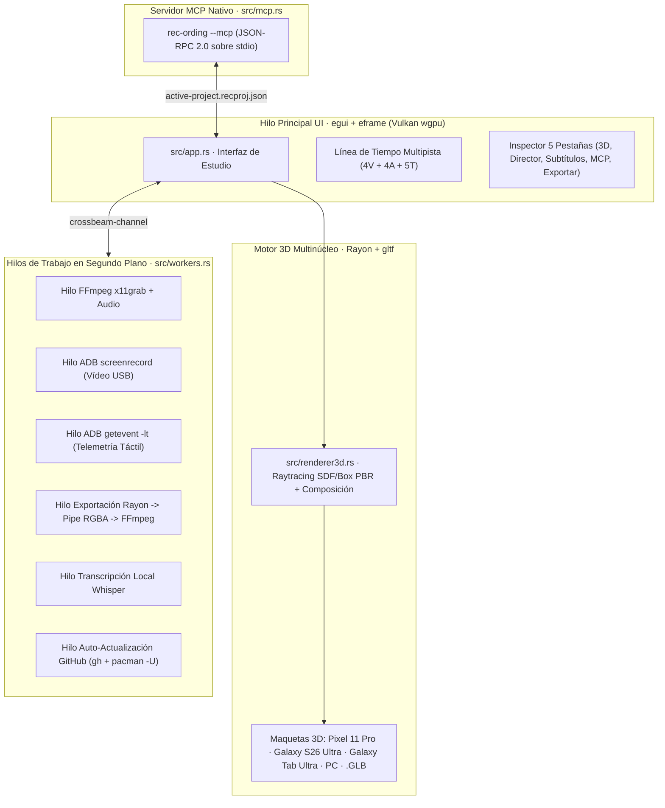

# rec-ording — Resumen de Implementación y Plan de Evolución

## 1. Visión General

**`rec-ording`** (`v0.2.0`) es un estudio nativo de escritorio para Linux (**CachyOS / Arch Linux**) orientado a desarrolladores de aplicaciones Android y escritorio que necesitan grabar demostraciones y producir vídeos promocionales con acabado 3D profesional para **Google Play Store**, **App Store**, redes o repositorios.

La aplicación está construida **100 % en Rust nativo puro**, prescindiendo por completo de Node.js, JavaScript y motores de navegador embebidos (WebView/WebKitGTK), para garantizar:
- **Cero pausas de recolector de basura (GC)** y consumo mínimo de memoria RAM.
- **Paralelismo real multinúcleo (`rayon`)** aprovechando todos los hilos lógicos de la CPU para el renderizado 3D y la composición de vídeo.
- **Aceleración gráfica sobre Vulkan (`wgpu` + `egui` / `eframe`)** para una interfaz inmediata a 60/120 Hz.
- **Tubería cruda (`rawvideo` RGBA por `stdin`) directa hacia FFmpeg** en hilos de trabajo dedicados (`std::thread` + `crossbeam-channel`).
- **Servidor MCP integrado en el propio binario ELF (`rec-ording --mcp`)** sin depender de tiempos de ejecución externos.

---

## 2. Arquitectura del Sistema Implementada

---

## 3. Resumen de lo Implementado por Área Funcional

### 3.1. Modelo de Proyecto Serializable (`src/model.rs`)
- Estructura completa del proyecto persistida en JSON (`active-project.recproj.json`), compartida entre la interfaz gráfica y el servidor MCP.
- Soporta 13 pistas independientes (**4 de vídeo `V1..V4`**, **4 de audio `A1..A4`**, **5 de texto `T1..T5`**), carril de **Cámara Director**, carril de **Máscaras de Privacidad**, telemetría de puntero/toques (`pointer_events`), teclas pulsadas (`key_events`), subtítulos palabra por palabra (`subtitles`) y ajustes de exportación (`export_settings`).

### 3.2. Grabación Multihilo y Telemetría USB/PC (`src/workers.rs`)
- **Detección de dispositivos Android por USB o emulador**: ejecuta `adb devices -l` y `adb shell wm size` en un hilo de fondo.
- **Captura simultánea PC + Android**:
  - Hilo dedicado para escritorio con `/usr/bin/ffmpeg -f x11grab -framerate 60` y captura de micrófono PulseAudio/PipeWire.
  - Hilo dedicado para vídeo Android por USB con `adb shell screenrecord --bit-rate 16000000`.
  - Hilo dedicado en tiempo real para `adb shell getevent -lt`, que interpreta eventos `ABS_MT_POSITION_X`, `ABS_MT_POSITION_Y` y `BTN_TOUCH` generando coordenadas normalizadas (`0.0..1.0`) y marcas de tiempo en milisegundos.

### 3.3. Motor 3D Multinúcleo y Acabado Visual (`src/renderer3d.rs`)
- **Paralelización con `rayon` (`par_chunks_mut`)**: cada línea de escaneo del fotograma se calcula en paralelo usando todos los núcleos del procesador.
- **Maquetas 3D incluidas**:
  1. **Google Pixel 11 Pro**: chasis metálico redondeado, barra trasera de cámaras en forma de píldora, perforación frontal centrada y pantalla OLED.
  2. **Samsung Galaxy S26 Ultra**: diseño de bordes rectos en titanio, anillos de cámara traseros y pantalla plana Infinity-O.
  3. **Samsung Galaxy Tab S10 Ultra**: formato tablet 16:10 ultra-delgado con orientación vertical/horizontal.
  4. **Ventana PC 3D**: marco flotante con botones de control y cabecera.
  5. **Cargador nativo `.GLB` / `.GLTF`**: inspección de mallas y vértices mediante el crate `gltf`.
- **Disposición Dual en 3D**: modos *Un dispositivo*, *Lado a Lado (PC + Android)*, *PiP Flotante 3D* y *Escaparate en Ángulo*.
- **Modo Director y Auto-Zoom**: interpolación de cámara 3D (`focus_x`, `focus_y`, `zoom`, `rot_x_deg`, `rot_y_deg`, `rot_z_deg`) con físicas *spring* y generación automática de movimientos de cámara a partir de los toques registrados.
- **Efectos de Acabado**: desenfoque de movimiento (*motion blur*) por velocidad de cámara, ondas táctiles en toques/clics, estelas en gestos *swipe*, máscaras de privacidad (*blur*, pixelado y sólido), títulos animados, HUD de teclas en pantalla y subtítulos con resaltado palabra por palabra.

### 3.4. Línea de Tiempo Multipista e Inspector (`src/app.rs`)
- **Línea de tiempo interactiva**:
  - Filtros rápidos (`Todas (13)`, `Vídeo (4)`, `Audio (4)`, `Texto (5)`).
  - Herramientas de edición sobre el clip seleccionado: **Dividir en cabezal (`Split`)**, **Congelar imagen (`+1.5s Freeze Frame`)**, **Cambios de velocidad (`0.5x`, `1.0x`, `1.5x`, `2.0x`)** y silenciamiento (`Mute`) por pista.
  - Carril dedicado para **Fotogramas Clave de Cámara Director** y cabezal de reproducción interactivo.
- **Inspector lateral de 5 pestañas**:
  1. `📱 3D & Estilo`
  2. `🎥 Director` (cámara 3D y zonas sensibles de privacidad)
  3. `💬 Subtítulos` (transcripción en hilo Rust + edición palabra por palabra)
  4. `🤖 MCP / IA` (configuración directa para Claude Desktop, Cursor y Codex)
  5. `🚀 Exportar` (presets Play Store / App Store y tubería FFmpeg)

### 3.5. Servidor MCP Nativo en Rust (`src/mcp.rs`)
- Se activa pasando `--mcp` al binario (`/usr/bin/rec-ording --mcp` o mediante el enlace `/usr/bin/rec-ording-mcp`).
- Implementa JSON-RPC 2.0 sobre `stdin`/`stdout` con 9 herramientas:
  - `get_project_summary`
  - `import_recording_clip`
  - `edit_clip`
  - `set_3d_mockup`
  - `plan_director_camera`
  - `add_privacy_mask`
  - `add_animated_title`
  - `update_subtitles`
  - `render_export_ffmpeg`

### 3.6. Exportación FFmpeg Multihilo y Empaquetado Arch/CachyOS
- **Exportación por tubería directa**: renderiza lotes de fotogramas en paralelo con `rayon` (`into_par_iter`) e inyecta los buffers RGBA en `pipe:0` de `/usr/bin/ffmpeg` hasta en **4K (3840×2160) a 60 fps**, soportando **H.264 (`libx264`)**, **HEVC (`libx265`)**, **AV1 (`libsvtav1`)**, **WebM VP9 con canal Alpha**, **ProRes 4444 Alpha**, **GIF en 2 pasos (`palettegen` + `paletteuse`)** y **PNG**.
- **Instalador nativo para CachyOS / Arch Linux (`packaging/arch/PKGBUILD`)**:
  - Genera el paquete `rec-ording-0.2.0-1-x86_64.pkg.tar.zst` instalable con `pacman -U`.
  - Auto-actualización integrada conectada al repositorio privado `github.com/blzkz/rec-ording`.

---

## 4. Plan de Evolución (Hoja de Ruta)

### Fase 1 — Completada (`v0.2.0`)
- [x] Migración completa a **100 % Rust nativo** (`egui` + `eframe` sobre Vulkan `wgpu`), eliminando Node.js, JS y WebKitGTK.
- [x] Motor de renderizado 3D paralelizado en todos los núcleos de CPU con `rayon`.
- [x] Captura multihilo de escritorio (`ffmpeg`) y dispositivos Android por USB (`adb screenrecord` + `getevent`).
- [x] Línea de tiempo de 13 pistas (4 vídeo, 4 audio, 5 texto) + Cámara Director + Máscaras de Privacidad.
- [x] Servidor MCP compilado en el propio binario (`rec-ording --mcp`).
- [x] Empaquetado nativo `.pkg.tar.zst` para CachyOS / Arch Linux, CI/CD en GitHub Actions y sistema de auto-actualización desde repositorio privado.

### Fase 2 — Decodificación de Vídeo por Hardware y Shaders WGSL Nativos (`v0.3.0`)
- [ ] **Pipeline 3D WGSL directo en `wgpu` (`RenderPipeline`)**: mover el sombreado PBR, el mapeo UV de texturas de vídeo reales y el *motion blur* acumulativo a *compute/fragment shaders* WGSL en GPU para liberar aún más la CPU durante exportaciones 4K.
- [ ] **Decodificación de vídeo por hardware (VAAPI / NVDEC)**: decodificar los archivos `.mp4` grabados desde ADB o PC directamente en texturas de GPU para previsualización en tiempo real de múltiples pistas de vídeo simultáneas.
- [ ] **Captura nativa en Wayland vía PipeWire (`ashpd` + `pipewire`)**: añadir soporte directo de portal XDG (`xdg-desktop-portal`) además de `x11grab` para sesiones Wayland puras en CachyOS (KDE Plasma / Hyprland).

### Fase 3 — Motor de Audio y Whisper.cpp Embebido (`v0.4.0`)
- [ ] **Integración de `whisper-rs` (`whisper.cpp` con aceleración Vulkan)**: ejecutar los modelos `.bin` de Whisper directamente en memoria dentro del proceso Rust con aceleración GPU Vulkan sin requerir binarios externos.
- [ ] **Previsualización de ondas de audio (Waveforms) y mezcla PCM en vivo (`cpal` / `rodio`)**: reproducción sincronizada de las 4 pistas de audio con envolventes de volumen y *ducking* automático cuando habla la voz en off.

### Fase 4 — Plantillas de Escaparate para Play Store y Exportación por Lotes (`v0.5.0`)
- [ ] **Plantillas listas para Google Play Store / App Store**: escenas preconfiguradas con transiciones entre múltiples dispositivos (por ejemplo, de teléfono Pixel 11 Pro a tablet Galaxy Tab Ultra en la misma secuencia).
- [ ] **Exportación simultánea multi-formato**: renderizar de una sola pasada el vídeo horizontal 16:9 (4K), el vertical 9:16 (Shorts/Reels) y las capturas PNG de alta resolución para la ficha de Google Play Console.
